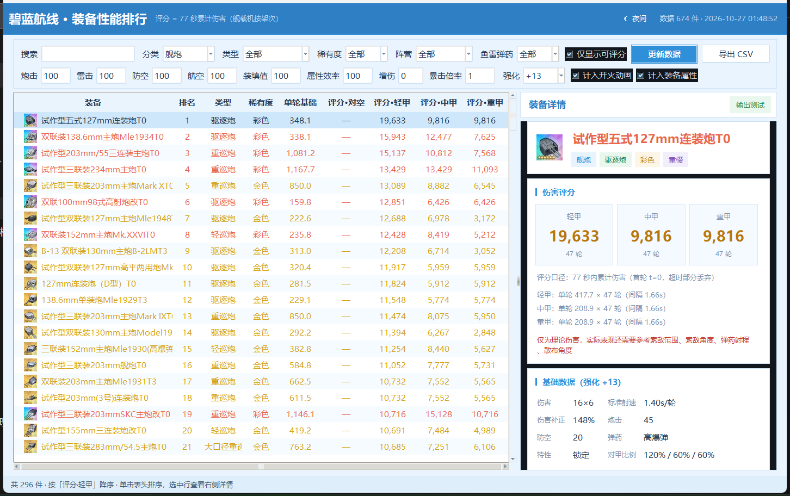
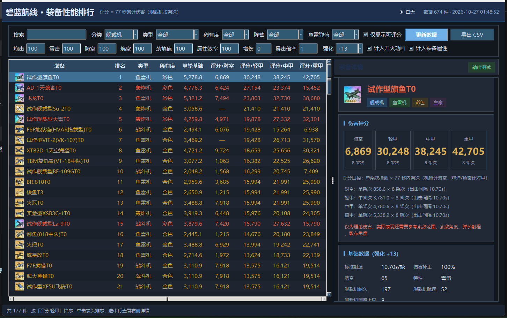

# 碧蓝航线 · 装备性能排行工具

**版本：v1.0** ｜ Windows 10 / 11 ｜ 免安装 ｜ 离线可用

抓取 [碧蓝航线 WIKI](https://wiki.biligame.com/blhx/装备图鉴) 的全部装备数据，
按伤害公式计算 **77 秒窗口内的累计伤害** 并自动排序，带图标、卡片式详情、白天/夜间主题。



| 夜间模式 |
|---|
|  |

---

## 下载

| 文件 | 大小 | 说明 |
|---|---|---|
| `碧蓝装备排行_v1.0.zip` | 16 MB | **推荐**。解压后双击 `碧蓝装备排行_v1.0\碧蓝装备排行.exe`，启动约 1 秒 |
| `碧蓝装备排行_v1.0_单文件版.exe` | 16 MB | 只有一个文件，双击即用；每次启动会解压到系统临时目录，首次约 3~5 秒 |

两个版本功能完全一致，按喜好选一个即可。

> 免安装：不需要装 Python，不需要管理员权限，运行库已随包带上。
> 数据与图标内置，**断网也能用**；只有「更新数据」按钮需要联网。

---

## 功能

- **674 件装备**：舰炮 296、舰载机 177、防空炮 119、鱼雷 80、导弹 2
- **统一评分口径**：全部按 77 秒累计伤害排名，四个维度分别排序——对空 / 轻甲 / 中甲 / 重甲
- **逐级强化**：无强化 ~ +13，装备够不到自动回退到自身最高档
  （白色飞机只能 +3，不会误用 +13 的数值）
- **舰载机拆解**：机枪计对空、炸弹/鱼雷计对甲，按架次折算到 77 秒
- **卡片式详情**：图标、标签、评分卡、计算过程、舰载挂载、技能、完整属性
- **白天 / 夜间主题**：一键切换并记住选择
- **筛选与搜索**：分类 / 类型 / 稀有度 / 阵营 / 鱼雷弹药 / 关键词
- **输出测试**：任意秒数下的总输出与等效秒伤
- **导出 CSV**：把当前排行表导出成表格

---

## 使用

1. 左侧表格点表头排序（例如「评分·轻甲」＝按对轻甲目标伤害排序）
2. 上方参数栏改炮击 / 雷击 / 防空 / 航空 / 装填值 / 强化档位，回车即重算
3. 选中任意装备，右侧显示评分拆解与原始数据
4. 右上角切换夜间模式

设置保存在 exe 同级 `data\settings.json`；若放在 `Program Files` 等无写权限的位置，
会自动改存到 `%LOCALAPPDATA%\AzurLaneEquipRank`。

---

## 评分口径

```
开火间隔 = 装填时间 × √(200 / (装填值 + 100)) + 开火动画
开火次数 = floor(77 / 开火间隔) + 1              # 首轮在 t=0
单轮伤害 = (1 + 属性/100 × 属性效率) × 单发 × 修正比例 × 对甲效率 × 弹数
评分     = 单轮伤害 × 开火次数                   # 对空 / 轻甲 / 中甲 / 重甲 各算一次
```

- 舰载机按**架次**折算：`架次 = floor(77 / 出击间隔) + 1`，单架次挂载伤害 × 架次
- 航弹属性效率 80%，火箭弹 / 鱼雷 / 机枪 100%
- 对甲比例按百分数参与计算（wiki 的 `75-110-75` 即 75% / 110% / 75%，110% 就是 ×1.10）
- 强化档位：页面写了就用页面值，缺档按 wiki 模板兜底（金/彩 +13 补正 = 基础 × 1.18）

**不计入**：命中率、散布、弹道、燃烧/进水、防空减伤。

> 所以这里的数字是**理论伤害**，用于横向比较。实际手感还要看索敌范围、索敌角度、
> 弹药射程、散布角度，以及弹幕与操作。

---

## 数据来源与声明

- 装备数据与图标来自 [碧蓝航线 WIKI（碧蓝海事局）](https://wiki.biligame.com/blhx/)，
  版权归 WIKI 及其编辑者所有
- 本项目仅做本地整理与计算，不用于商业用途，不二次分发原始素材牟利
- 评分是对游戏公式的近似实现，与游戏内实际表现可能存在偏差，仅供参考

---

## 技术栈

Python 3.12 + tkinter，PyInstaller 打包（onedir / onefile）。
界面不依赖第三方库，图标用 `tk.PhotoImage` 加载。

<details>
<summary>从源码运行 / 自行打包（开发者）</summary>

```bash
python main.py                      # 源码运行
python -m unittest discover -s tests -v   # 回归测试（68 条）
powershell -File build.ps1          # 打包免安装版 → dist\碧蓝装备排行
powershell -File build.ps1 -OneFile # 打包单文件版 → dist\单文件版
```

目录：`app/core.py` 抓取解析评分 ｜ `app/ui.py` 界面 ｜ `tools/` 抓取与截图脚本 ｜ `docs/` 计算逻辑与开发文档

</details>

---

## 发布说明

```
v1.0 — 首个公开版本

· 674 件装备数据（舰炮 / 舰载机 / 防空炮 / 鱼雷 / 导弹），图标齐全
· 77 秒窗口累计伤害统一评分，四个维度：对空 / 轻甲 / 中甲 / 重甲
· 舰载机按架次折算，机枪计对空、炸弹与鱼雷计对甲
· 逐级强化（无强化 ~ +13），装备够不到时按自身上限计算
· 白天 / 夜间主题、卡片式详情、输出测试、CSV 导出
· 免安装版与单文件版两种形式，运行库与数据全部内置，离线可用

已知限制：
· 评分是理论伤害，不含命中、散布、弹道，实际表现请结合索敌范围与散布角度
· 紫色及以上装备的强化上限仍按 WIKI 页面原始值处理
```

---

## 许可

[MIT](LICENSE)
