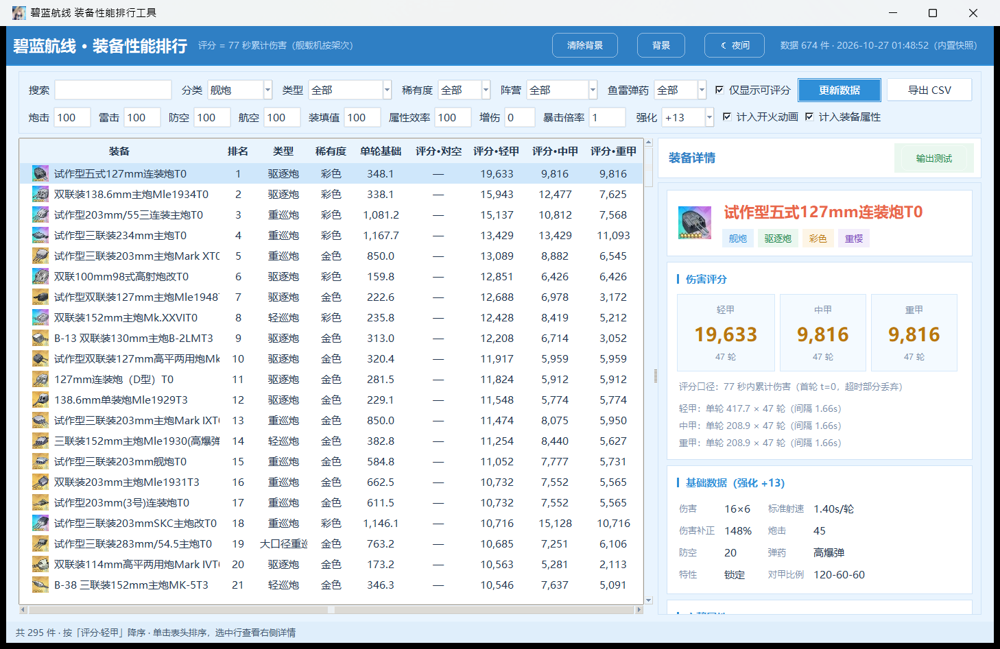
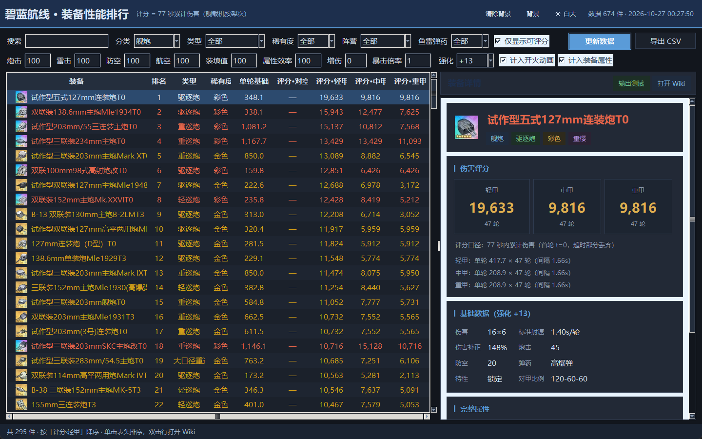

# 碧蓝航线 · 装备性能排行工具


抓取 [碧蓝航线 WIKI](https://wiki.biligame.com/blhx/%E8%A3%85%E5%A4%87%E5%9B%BE%E9%89%B4) 的全部装备数据，
按伤害公式计算 **77 秒窗口内的累计伤害** 并自动排序，带图标、卡片式详情与白天/夜间主题。

**Windows 10 / 11 ｜ 免安装 ｜ 离线可用**

| 白天 | 夜间 |
|---|---|
|  |  |

## 下载

| 发布包 | 说明 |
|---|---|
| [GitHub Releases](https://github.com/liming1334/AzurLane-GearReview/releases) | 下载最新 Release 中的单文件版 exe（当前为 `v1.0.0.exe`），双击即用，约 16 MB |

> 单文件版首次启动会解压到系统临时目录，约 3~5 秒；个别杀毒软件可能误报，加入白名单即可。
> 数据与图标已内置，**断网也能用**；只有「更新数据」按钮需要联网。

## 功能

- **674 件装备**：舰炮 296、舰载机 177、防空炮 119、鱼雷 80、导弹 2
- **统一评分口径**：舰炮/导弹/鱼雷/防空炮/舰载机全部按 77 秒累计伤害排名
- **逐级强化**：无强化 ~ +13，装备达不到自动回退到自身最高档
  （白色飞机只能到 +3，不会误用 +13 的数值；白/蓝按稀有度上限截断页面虚高档位）
- **四种评分维度**：对空 / 轻甲 / 中甲 / 重甲，可分别排序
- **筛选与搜索**：分类 / 类型 / 稀有度 / 阵营 / 鱼雷弹药 / 关键词
- **卡片式详情**：图标、标签、评分卡、计算过程、舰载挂载、技能、完整属性
- **输出测试**：任意时长（默认 77 秒）的总输出与等效秒伤
- **导出 CSV**：把当前排行表导出成表格
- **白天 / 夜间主题**：白色 + 天蓝 / 灰黑 + 深蓝（输入框 #305973），一键切换并记忆
- **离线可用**：数据与图标内置；「更新数据」可联网重抓

## 快速开始

从 [GitHub Releases](https://github.com/liming1334/AzurLane-GearReview/releases) 下载
单文件版 exe（当前为 `v1.0.0.exe`），双击运行。

从源码运行：

```bash
python main.py
```

## 评分规则摘要

### 舰炮 / 导弹 / 鱼雷 / 防空炮

```
开火间隔 = 装填 × √(200/(装填值+100)) + 开火动画
开火次数 = floor(77 / 开火间隔) + 1        # 首轮 t=0，超 77 秒丢弃
单轮伤害 = (1 + 属性/100 × 属性效率) × 单发 × 修正比例 × 对甲效率 × 弹数
评分     = 单轮伤害 × 开火次数
```

### 舰载机（含水上机 / 反潜机）

```
单架次对空 = Σ(机枪单发 × 数量) × (1 + 航空/100 × 效率)
单架次对甲 = Σ(炸弹/鱼雷单发 × 数量 × 对甲%) × (1 + 航空/100 × 效率 × 武器效率)
架次       = floor(77 / 出击间隔) + 1
评分       = 单架次 × 架次
```

航弹属性效率 80%，火箭弹 / 航空鱼雷 / 机枪 100%。

完整推导、边界条件与参数含义见 **[docs/计算逻辑.md](docs/计算逻辑.md)**。

## 目录结构

```
app/            核心逻辑与界面
assets/         图标、预览图
data/           装备数据
docs/           计算逻辑 / 开发文档
tests/          回归测试
tools/          抓取、图标、截图与端到端脚本
main.py         程序入口
build.ps1       单文件打包脚本
使用说明.txt     用户说明
```

`vendor/` 是本地打包依赖（PyInstaller 等），不入库；需要重新打包时可保留或自行安装。
`打包/` 是 `build.ps1` 的本地输出目录，同样不入库；发布时把 exe 上传到 GitHub Releases。

## 数据更新

```bash
python tools/crawl.py        # 重新抓取装备数据 → data/equipment.json
python tools/fetch_icons.py  # 重新下载图标 → assets/icons/
```

界面里的「更新数据」按钮执行同一套流程。

## 测试

```bash
python -m unittest discover -s tests -v
```

共 **68 条用例**，只用标准库（本项目装不了 pytest）。覆盖强化档位选择、机枪射速解析、
舰载机 77 秒架次、舰炮开火次数与对甲、以及数据体检（674 件、图标齐全）。
其中 `TestMaxLevelTruncation` 专门钉住「白色飞机只能 +3，不能误用武器库 +13」这个历史 bug，
`TestEffectiveMaxLevel` 钉住白/蓝按稀有度上限截断、紫及以上不动，
`TestUi` 钉住「反复切换装备时详情控件必须整体销毁」（曾导致详情错位）。
界面测试需要能创建 Tk 窗口，无显示环境会自动跳过。

## 打包

```powershell
powershell -ExecutionPolicy Bypass -File build.ps1
```

输出：`打包/碧蓝装备排行_单文件版.exe`（本地目录，已在 `.gitignore` 中忽略）。

发布时把生成的 exe 上传到 GitHub Releases，不要提交进 Git 仓库。

打包依赖 PyInstaller；仓库内可保留本地的 `vendor/`，或先执行 `pip install pyinstaller`。
单文件模式启动时需要可写的临时目录；若运行环境不允许，可改用 `python main.py` 从源码运行。

## 开源协议

[MIT](LICENSE)。装备数据与图标版权归 **碧蓝航线 WIKI** 及其编辑者所有，
本项目仅做本地整理与计算，不做二次分发牟利。

## 致谢

- 数据来源：[碧蓝航线 WIKI](https://wiki.biligame.com/blhx/)（碧蓝海事局）
- 伤害公式参考 WIKI「公式合集 · 伤害公式」条目
